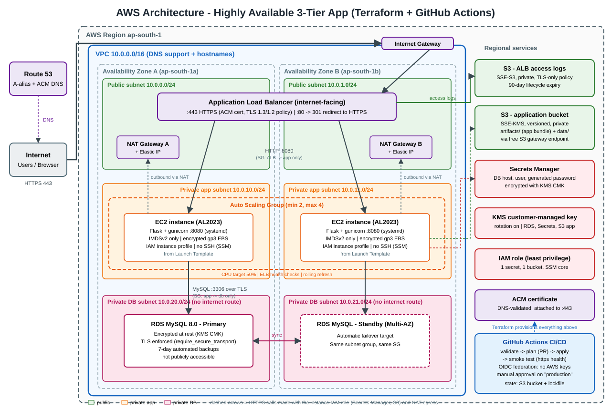

# DevOps Practical Task - AWS Infrastructure & CI/CD

A highly available 3-tier web application on AWS, provisioned entirely with **Terraform** and deployed through a **GitHub Actions** pipeline.

```
Internet --HTTPS--> Application Load Balancer --> Auto Scaling EC2 (private subnets, 2 AZs) --> RDS MySQL (private, Multi-AZ)
                          |
                          +--> S3 (ALB access logs)
```



| Item | Where |
|---|---|
| Application source | [`app/`](app) |
| Terraform (infrastructure) | [`terraform/`](terraform) |
| One-time bootstrap (state bucket + GitHub OIDC roles) | [`bootstrap/`](bootstrap) |
| GitHub Actions workflow | [`.github/workflows/terraform.yml`](.github/workflows/terraform.yml) |
| Architecture diagram | [`docs/architecture.svg`](docs/architecture.svg) |
| Deployment documentation | [`docs/DEPLOYMENT.md`](docs/DEPLOYMENT.md) |
| Screenshots | [`docs/screenshots/`](docs/screenshots) (checklist in [`docs/SCREENSHOTS.md`](docs/SCREENSHOTS.md)) |
| Live URL | _add your `https://...` URL here after deployment_ |

## What gets built

**Networking** - VPC `10.0.0.0/16` across 2 AZs; public subnets (ALB, NAT), private app subnets, and isolated private DB subnets with no internet route; Internet Gateway; one NAT Gateway per AZ; separate route tables per tier; free S3 gateway endpoint.

**Compute** - Launch Template (Amazon Linux 2023, IMDSv2 only, encrypted gp3 volumes, no SSH - access via SSM Session Manager) behind an Auto Scaling Group (min 2 / max 4, CPU target-tracking at 50%, ELB health checks, rolling instance refresh whenever the app code changes).

**Load balancing / TLS** - Internet-facing ALB. Port 443 terminates TLS with a DNS-validated **ACM** certificate (TLS 1.3/1.2 policy); port 80 only issues a 301 redirect to HTTPS. Access logs go to S3.

**Database** - RDS MySQL 8.0 in private subnets, Multi-AZ, encrypted with a customer-managed KMS key, TLS enforced server-side (`require_secure_transport`), not publicly accessible, 7-day backups.

**Secrets** - A random DB password is generated by Terraform and stored in **AWS Secrets Manager** (KMS-encrypted) together with the endpoint. Instances fetch it at runtime via their IAM role; nothing is baked into images, user-data, or environment files.

**Storage** - Application bucket (SSE-KMS, versioned, private, TLS-only policy) and ALB-log bucket (SSE-S3 as required by ALB log delivery, 90-day lifecycle, TLS-only policy).

**CI/CD** - `validate` (fmt, validate, Checkov, Python syntax) -> `plan` (read-only role, on PRs and `main`) -> `apply` (behind a manual approval on the `production` environment) -> `smoke-test` (HTTPS health, HTTP->HTTPS redirect, TLS cert, DB and S3 checks). Authentication uses **GitHub OIDC**, so there are no long-lived AWS keys in GitHub.

## Application endpoints

| Path | Purpose |
|---|---|
| `/` | Shows instance ID, AZ, and a DB-backed visit counter (refresh to see load balancing across AZs) |
| `/health` | Liveness - used by the ALB target group |
| `/health/db` | Deep check: Secrets Manager -> RDS over TLS |
| `/storage-check` | Writes an object to the app S3 bucket using the instance role |

`/health` is deliberately independent of the database so a database blip cannot cause the ALB to drain every instance at once; `/health/db` is used by the pipeline's smoke test instead.

## Security summary

| Area | Implementation |
|---|---|
| Network | Only the ALB is public. App SG accepts 8080 from the ALB SG only; DB SG accepts 3306 from the app SG only; DB has no egress rules and no internet route |
| Transport | HTTPS-only (HTTP redirects); RDS requires TLS; S3 policies deny non-TLS |
| At rest | RDS, Secrets Manager and app bucket use a KMS CMK with rotation; EBS encrypted; log bucket SSE-S3; state bucket SSE-S3 + versioning |
| Secrets | Secrets Manager; password generated, never typed or committed |
| IAM (instances) | One secret, one bucket (read-only on `artifacts/`, read/write on `data/`), KMS only via Secrets Manager/S3, plus SSM core |
| IAM (pipeline) | OIDC; read-only plan role for PRs; apply role assumable **only** from the protected `production` environment; IAM and S3 scoped to the project name prefix |
| Instances | IMDSv2 required, no SSH key pair, no port 22, systemd service runs as an unprivileged user with `NoNewPrivileges` |

## Design decisions and trade-offs

- **App delivery**: Terraform zips `app/` into the app bucket; instances pull it at boot. The bundle key is a content hash, so changing app code changes the launch template and triggers a rolling refresh - no separate image pipeline needed for this scope. In production I would bake an AMI or ship a container.
- **Two NAT gateways** (one per AZ) so losing an AZ does not cut off the other AZ's outbound access. `single_nat_gateway = true` halves that cost for a demo.
- **State**: S3 backend with native lockfile (`use_lockfile`, Terraform >= 1.10) - no DynamoDB table needed.
- **Apply without a saved plan file**: a plan artifact would contain the generated DB password in plaintext, so the apply job re-plans and applies inside the approval-gated environment.
- **DB password in Terraform state**: Terraform has to know the password to set it on RDS. The state bucket is private, encrypted, versioned and TLS-only. RDS-managed master secrets with rotation would avoid this and are the first thing I would change for production.
- **Demo-friendly defaults**: `db_deletion_protection=false`, `db_skip_final_snapshot=true`, `s3_force_destroy=true`, `secret_recovery_window_days=0` so `terraform destroy` leaves nothing behind. Flip all four for a real environment.

## Possible next steps

WAF on the ALB, CloudWatch alarms + SNS, VPC flow logs, RDS Performance Insights, Secrets Manager rotation, interface VPC endpoints (Secrets Manager / SSM) to remove the NAT dependency for AWS API calls, Terraform modules per tier, and a container-based deploy.
